<h1 align="center">Thought Keeper</h1>

<p align="center"><em>An automatic Zettelkasten over the claims of your sources.</em></p>

<p align="center">
  <a href="https://go.dev"></a>
  <a href="https://svelte.dev"></a>
  <a href="https://www.sqlite.org/fts5.html"></a>
  <a href="LICENSE"></a>
  <a href="https://github.com/TheFranconianCoder/thought-keeper/releases"></a>
  <a href="#local-first-by-construction"></a>
</p>

<p align="center">
  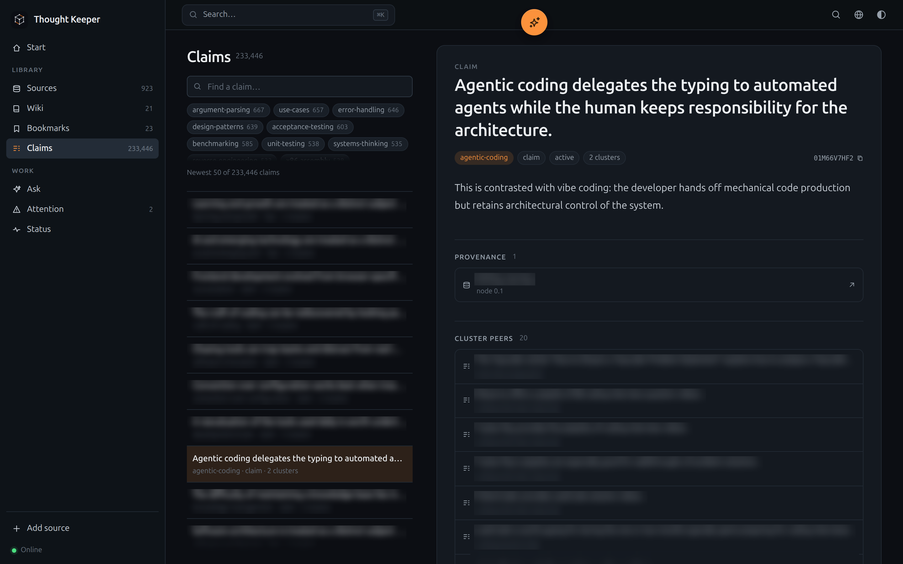
</p>

Thought Keeper is a **local-first desktop knowledge base** that reads the sources you give it and
distills them into **atomic claims** — one self-contained statement per file. The claims are linked
into **titleless associations**, and the connections are as valuable as the claims themselves.

It is not a chat window over your PDFs and it is not a RAG pipeline. There are **no embeddings, no
vector database and no cloud**: retrieval is reasoning over hierarchical outlines, lexical indexes
and the associations between claims. Sources are read once, the knowledge stays on your disk, and the
whole vault is plain Markdown, SQLite and JSON you can read, grep, version and back up.

> **The one-liner:** an automatic Zettelkasten over the claims of your sources.

---

## Why this exists

A folder of PDFs is not knowledge. A chat answer is not a note. Most "ask your documents" tools
solve the lookup problem and lose the thing that made Vannevar Bush's Memex interesting: the
**trails** between what you have read.

Thought Keeper separates four things that are usually mixed together:

| Layer | Holds | Who writes it |
| --- | --- | --- |
| **Sources** | what was actually said — content-addressed snapshots | you add them; everything is write-once, except two deliberately mutable addresses (a URL snapshot and a wiki page's representation) |
| **Claims (atoms)** | what the vault *believes* — one statement, one flat topic, provenance to a source node | the agent |
| **Associations** | what travels together — titleless clusters of claims | derived, deterministically |
| **Wiki pages** | what *you* write — Markdown with a title and tags | you |

A claim is the unit of knowledge, not a chunk. It stands on its own: a reader who has never seen the
source can understand it. Its provenance points at a node of the source that produced it, so every
belief has a traceable address. Claims are then grouped by content — not by document — which is what
makes cross-source connections appear without asking a model for them.

---

## A first look

The desktop window is the PWA; the same vault on a phone gets the narrow layout with the footer
navigation.

| | |
| --- | --- |
| 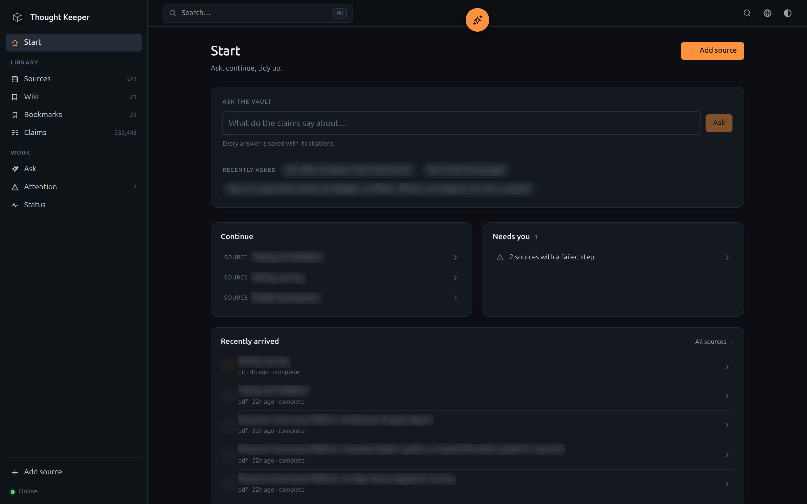 | **Start.** The front door: an Ask box with the last questions, Continue, Needs you and the newest sources with their live step state. |
| 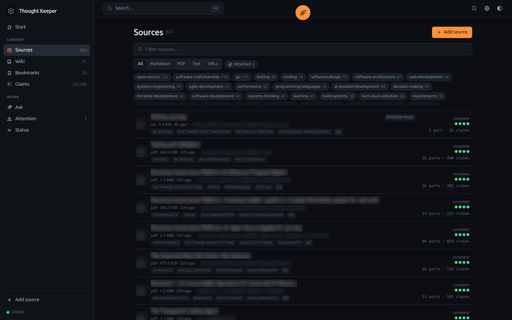 | **Sources.** Markdown, PDF, text and URL snapshots in one list, with a persistent search, type and attachment filter; a hand-attached snapshot carries a paperclip badge. |
| 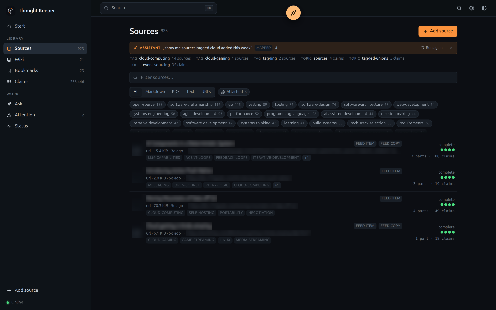 | **The assistant.** One request resolves to a lens, a filter and a set; the result is an ordinary list with a banner that says how it was read. |
| 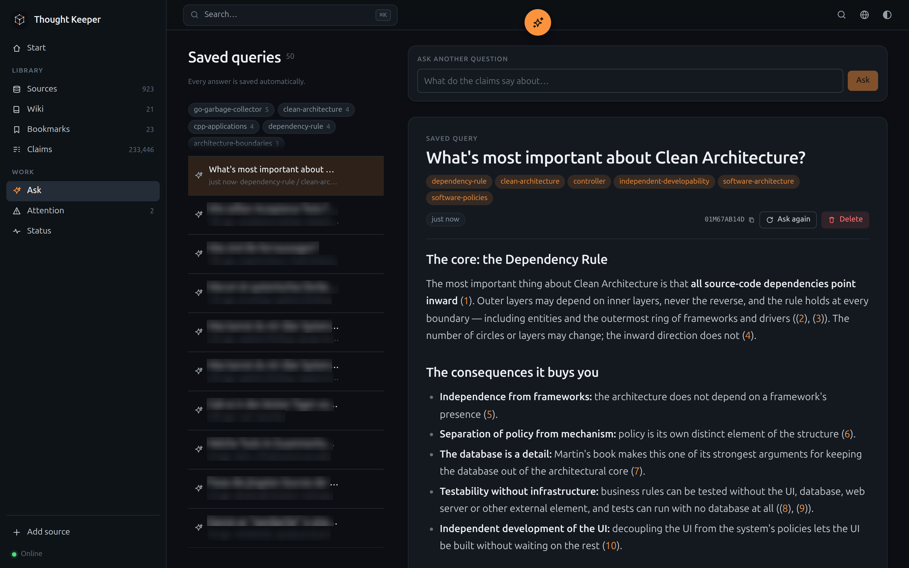 | **Ask.** Questions answered from claims, with inline citations, saved as notes with automatic tags. |
| 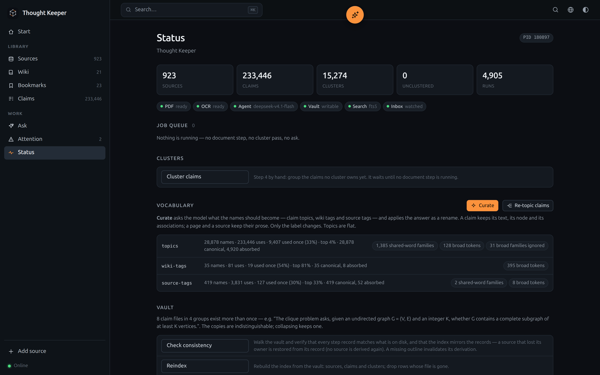 | **Status.** Counts, job queue, maintenance actions, vocabulary health, live and peak memory. |

<p align="center">
  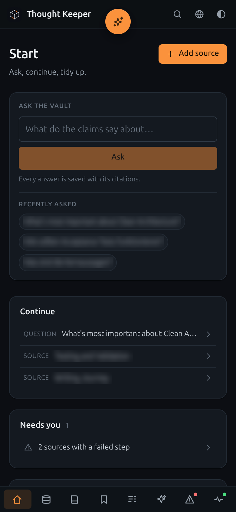
  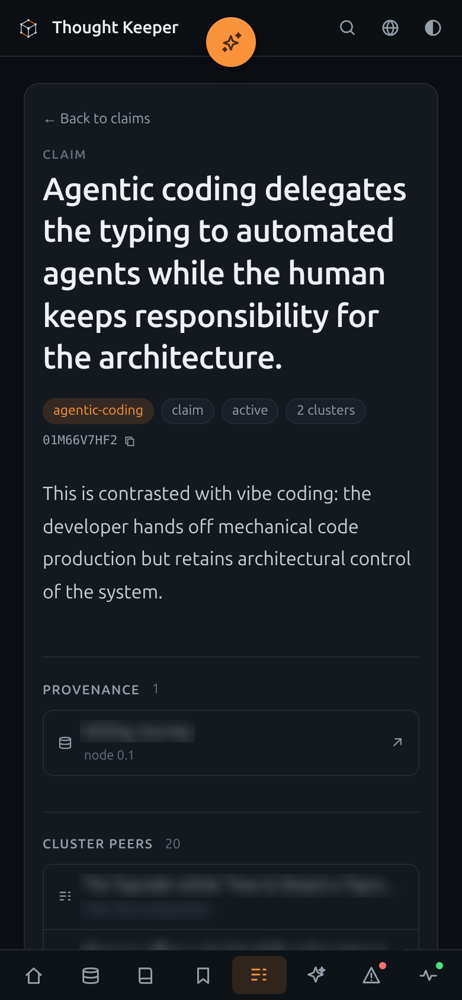
  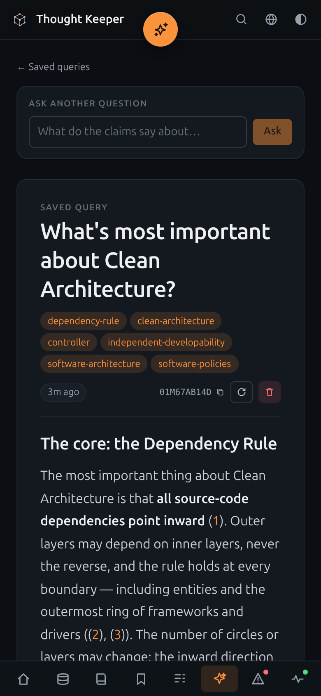
  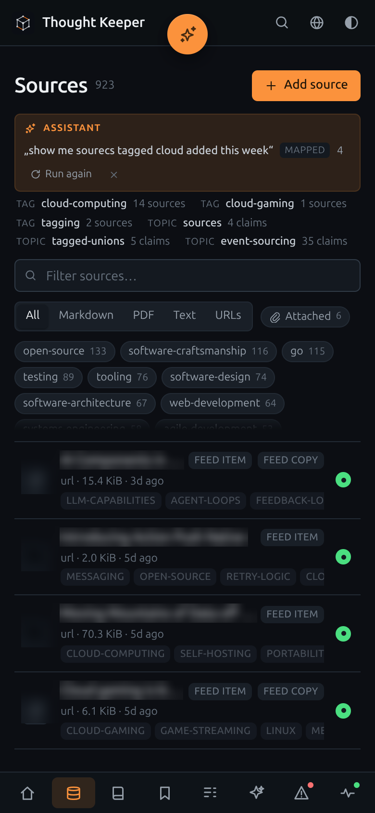
</p>

The full list of captures the README expects lives in
[`docs/screenshots/README.md`](docs/screenshots/README.md).

---

## The pipeline

Four steps, strictly separated, in this order:

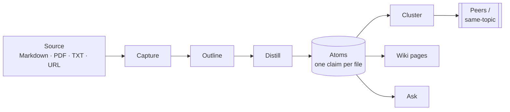

1. **Capture** makes the source readable locally. Markdown and text already are; a PDF gets its text
   layer (poppler) or is OCR'd page by page (poppler + tesseract); a URL is fetched and stored as a
   static snapshot. A URL that turns out to be a **sitemap** or an **RSS/Atom feed** is not a page at
   all: it becomes a parent source whose snapshot is the list it declared, and the pages it names are
   fetched as sources of their own. A page behind a **login or a paywall** is reported as blocked — the
   app never stores a credential and never distils a login form. Capture never guesses: if a scanned
   PDF has no text and OCR is unavailable, the source is flagged `unsupported_source`, never silently
   empty.
2. **Outline** builds the document's hierarchical tree: titles, summaries and **references** into the
   readable text. The tree stores structure, not text.
3. **Distill** runs the agent over **one text-bearing node at a time**: every statement becomes its
   own atom with a flat topic, a type, and provenance to that node. The agent then audits the part
   against its claims until nothing is missing. A part is done when its own text is covered, not when
   a citation count looks good.
4. **Cluster** groups the claims into **titleless clusters** — deterministically, with no model. Sparse
   IDF-weighted neighbours, merge/split gates, a hard cluster-size cap and a configurable membership
   cap (two by default). A cluster has no title and no page; it exists so a claim can show its
   peers.

The first three are **document steps** (one source, in order). The cluster step runs over the whole
vault and may only run while no document step runs — in both directions. **Ask is never gated** and
answers questions in parallel (`pipeline.parallel_queries`).

**After a complete distillation** a source earns a **summary** (`<hash>.summary.md`): a short
overview written from its claims in the configured summary language (`language.summary`, default
English), shown on its own tab. The consistency job fills in summaries that
are missing, a few at a time, so a vault from before the feature catches up in the background.

Every source carries the state of its steps (capture, outline, distill) and of its parts, so a long
book converges over several runs, a restart continues where it stopped, and a failure is a red light
with a reason — never a silent green one.

---

## What is in the app

The PWA is claim-first and deliberately calm: the sidebar is a finite set of **lenses**, not a menu
of features.

### Start

The front door, not a data dump: an **Ask** box with the three latest questions, **Continue** (the last
sources, claims, wiki pages and questions you opened — local memory, not a vault record), **Needs you**
(failed sources, findings and unclustered claims; quiet when there is nothing), the five newest sources
with their live step state, and one calm vault-pulse line. A new vault starts with "add the first
source" here.

### Claims

- One claim per atom file with a flat topic (in the configured claim language, default English),
  type, status, a 1–3 sentence body and **node-level provenance**. Names, code and quoted terms keep
  their original script.
- A detail view that shows where the claim came from, and two **disjoint** relation lists: its
  **cluster peers** (what it travels with) and the claims under the **same topic**.
- A local FTS5 finder in the lens and a **command palette** (⌘K / Ctrl-K) across claims and sources.
- No human authoring of claims: the human curates sources, writes wiki pages and asks questions. The
  API can write for tooling, but the claim workflow belongs to the agent.

### Sources

- **Markdown, PDF, plain text and URLs** — and nothing else. Drop files into `inbox/`, add a path,
  upload, paste links, or add an RSS/Atom feed.
- Content-addressed storage: a file source is its SHA-256, deduplicated and write-once. A URL's
  address is a hash of the URL, so refreshing a page replaces the snapshot without creating a second
  source; a wiki page's representation is the other deliberately in-place exception.
- Every source is one folder entry with its whole story: the object, the capture rendering, the step
  record, the outline, the summary and its own append-only **log**.
- **A source page has tabs**: content/PDF, the live page (URLs), the log, the files, the summary, and
  sub-sources. URL addresses are clickable — in the frontmatter, the rail and the **Open URL**
  action. Every text field has a clear (×) button.
- **Sitemaps and RSS/Atom feeds** expand into page sources they own. A sitemap is a complete list, so
  it is reconciled 1:1 (a page that leaves it is removed); a feed only ever extends — a page that
  leaves it stays, and only deleting the feed removes its pages. **A feed that carries the post solves
  the JavaScript page**: the item's own copy becomes the page's snapshot (marked `from feed`), so a
  page that only resolves in a browser is still readable — and a later readable page replaces the copy.
  **Wiki pages** own the URLs they brought in, also 1:1. The **Sub-sources** tab lists them, and an
  owned source cannot be deleted apart from its owner. A URL you add yourself always wins: it is
  released from any page/sitemap/feed that had claimed it. Two URLs that differ only by a trailing
  slash are one source.
- **A page behind a login or a paywall is reported, not guessed.** The app never stores a credential
  and never drives a browser: it names the gate (`login required`, `paywalled`), never distils a
  login form, and offers **Attach snapshot…** — save the page in your browser as HTML or PDF (for a
  JavaScript page, print it to PDF) and the URL keeps its address while the file becomes its snapshot.
  The same button is offered for a **bookmark** (a page that only renders with JavaScript). URLs are
  re-checked weekly (a feed daily); an attached snapshot is never fetched automatically, but its
  source page can **replace** it or **try the URL again** — a readable page then regularizes it, a
  wall keeps it.
- **Tags — human and derived**: the same coarse labels a wiki page carries. Edit the human ones in
  the detail rail; the agent writes **auto tags** from the source's claims after a complete distill,
  and the consistency job backfills sources that predate the feature. Both are observed by the
  **source-tags** vocabulary (a separate namespace from wiki tags). They appear as chips in every
  Sources row and as a tag cloud above the list (counted once per source); the search and the tag
  filter match either kind.
- **Bookmarks** are URLs that cannot be read (a video, a JavaScript app): kept as metadata-only
  sources and collected in their own lens, never distilled. A page that answers with a login or a
  paywall is **blocked** instead, so it never becomes a bookmark that pretends there was no text.
- **Pages and sitemaps are re-checked once a week, feeds daily** (configurable, and on demand), with
  a per-source and per-page HTTP status; broken links stay visible. A sitemap is reconciled against
  its list 1:1; a feed only extends. A URL you add yourself wins over any page, sitemap or feed that
  had claimed it.

### Associations

- Clusters are **titleless** and never listed: there is no cluster page, no cluster title, no cluster
  tag, and never a destination. The association becomes visible only as a claim's peers.
- Membership is many-to-many with a configurable cap (two by default, `overlap_max`), so a claim can
  sit in a couple of neighbourhoods without becoming a hub.
- Clusters are a **cache**: delete `clusters/` and the next pass derives them again from the claims.
- The cluster pass is deterministic and memory-conscious: it streams the claim corpus instead of
  loading a map per claim, holds term vectors as flat interned arrays, and reports its heap peak in
  Status.

### Wiki pages

- User-authored Markdown with a **title, human tags and derived tags** (kept apart, so an automatic
  tag never re-adds one you deleted).
- Saving a page writes a **source representation** and runs it through capture → outline → distill,
  so a page's prose produces claims like any other document — without the wiki and the Zettelkasten
  sharing a table.
- Pages are files (`wiki/<ab>/<cd>/<id>.md`), the source of truth, with a stable ULID and a stable
  source address (`WikiHash`).
- A page's linked URLs become owned sources and appear in the sub-sources tab of the page's source
  representation.

### Ask

- Ask a question; it appears **directly in the saved-query list with its status** while the answer is
  written — there is no separate “thinking” box — and questions run **in parallel**, so the next one
  can be asked immediately. A saved row opens, asks the same question again or deletes it, like a
  source row.
- The agent searches claims, reads at most a few, and answers with **inline citations**
  to the claims it used. Cite a claim, open it, come back: the scroll position survives the detour.
- The answer is written **entirely in the language of the question's prose**; proper names and source
  titles keep their original script and never switch the answer's language.
- Every answer is saved as a Markdown note in `asks/`, with the question, the run and **automatic
  tags** derived from the topics of the claims it cited. Its detail shows the **Ask ID** with a copy
  button.
- Ask is never blocked by a document or cluster run.

### Search

- **Vectorless and multilingual.** SQLite **FTS5** over claims, plus a plain field match over the
  **Sources** list (title, original name, URL, tags). A language hint per source tunes morphology; the
  hint never filters results.
- Hierarchical trees for reading a document part by part, and cluster memberships for "what travels
  with this claim".
- `similarity ≠ relevance`: no cosine similarity over chunks, no nearest-neighbour store, no vector
  database anywhere.

### Attention

A lens over existing state, not a second health model: **failed source steps** (capture/outline/
distill) and **non-info lint findings**. Every row opens the thing that needs the decision.

### Bookmarks

URL sources that exist as metadata only — the link you saved because the page could not be read. They
keep their HTTP status, favicon and last check, and stay out of the derivation pipeline.

### Status

- Index counts, the global pipeline state, and the **job queue**: what is running, what is queued,
  and which source it is about.
- The **summary backfill** while it runs: how many overviews are missing, queued and running, and
  when the backlog was measured.
- Maintenance actions (reindex, rebuild trees, consistency check, cleanup, duplicate collapse,
  cluster pass, vocabulary curation).
- Vocabulary health per namespace: canonical names, what they absorbed, near-duplicate families and
  broad tokens.
- **Memory**: live heap, peak heap and which pass caused the peak.
- All of it is also served by `GET /api/v1/status`, so the CLI doctor and the PWA cannot disagree.

### Vocabulary

Names are decisions, not strings. Three namespaces — claim **topics**, wiki **tags** and source
**tags** (human and derived) — keep a canonical set, an alias table of what was absorbed, and **broad tokens** learned
from *this* vault for near-duplicate detection. The agent curates them (`curate`, `retopic`, `broad tokens`); a distill run
applies the alias table at write time, so a merged name is not reinvented by the next run.

### Audit

Every agent operation is a **run** (`pipeline`, `query`, `lint`, `vocabulary`, `tag`, `summary`) with
model, status, token counts, iterations, answer and error. Every source has its own log with one line
per event. Runs are append-only; the audit is not rebuilt from anything.

### The assistant

The assistant is a **command line, not a chat**. A permanent button in the top bar (`⌘J`) opens one
field: say what to show, and the app resolves it into a lens, a filter and a set. The request is read
once and the result is an ordinary list — one request, one GUI state. It is not a lens and has no page
of its own.

- **Names come from the vault.** The model only turns your words into terms; the matching runs against
  the vault's own topics and tags, with the curated alias table, word stems, edit distance and Cologne
  phonetics. Without a model the request's own words are matched, and the record says so.
- **Commands are records.** Each request keeps its utterance, the criteria it was read as (e.g.
  `tag cloud · added ≤ 7 days · not finished`), the count and the materialized set. A result carries a
  banner with "run again" and "keep as a filter"; the address names the record, so it expires when the
  record is pruned after `assistant.retention` (a week by default).

---

## Local-first by construction

- **Loopback only.** The HTTP service binds `127.0.0.1` (fixed or ephemeral), no auth token, no CORS,
  no multi-user. It is your desktop, not a server.
- **One binary, one instance.** The app takes a vault lock, writes its runtime endpoint, and a second
  launch opens the first instance's UI instead of starting a second service.
- **The PWA is the UI.** Svelte 5 + Vite, embedded with `go:embed` and served from the same origin.
  Install it from Chromium/Edge and it opens as a real window; the tray is pure Go, zero CGO, and
  autostart is opt-in.
- **The vault is the truth.** `index.db`, the outlines and the clusters are caches; claims, sources,
  wiki pages, vocabulary and the run audit are files. Delete the index and `reindex` rebuilds it from
  the vault. The app never rebuilds a vault from an index it does not recognize; it reports the shape
  mismatch and leaves the decision to you.
- **No telemetry.** The only network calls are the sources you add and the model endpoint you
  configure.
- **Graceful shutdown.** Quit finishes or aborts running runs, flushes the index, releases the vault
  lock.

---

## Built for a grown vault

The interesting documents are big and the vault grows. The app takes that seriously:

- The **cluster pass** walks the claims as a page-by-page stream and keeps its term vectors in flat,
  interned arrays instead of a map per claim. A pass over a 170k-claim vault costs a stream-sized
  working set, not a gigabyte.
- List and detail reads are **scoped**: only the page's claims, sources and memberships are hydrated.
  A 23-byte "this source has no claims" response does not load 248k membership rows.
- The **consistency check** runs at startup and on a schedule, in slices, without holding the
  pipeline gate while it only reads. It verifies that every step record matches a file on disk,
  invalidates derivations whose artefact is gone, repairs lost identities and missing languages, and
  restores a source row's **owner** from its record — a source page never silently loses the wiki
  page, sitemap or feed it belongs to.
- **No silent writes and no invented records.** A failed step is recorded; a dead link is listed; a
  missing file is a visible red light, not a blank page.
- `app.memory_limit_mb` sets a soft Go heap ceiling, and Status reports the peak with the pass that
  caused it.

---

## How retrieval works

No embeddings. A question is answered by **reasoning over structures that already exist**:

| Need | Structure |
| --- | --- |
| Find a claim | FTS5 lexical index over claim, body and topic; language-aware |
| Read a document | the outline tree: one part = one text-bearing node, with references into the text |
| Related claims | cluster memberships (peers) and the flat claim topic |
| Answer a question | the agent's bounded tools: `list_topics`, `search`, `read_atom`, `list_atoms` |

The Claims detail exposes the association exactly where it belongs — `GET /api/v1/atoms/{id}/related`
returns **two disjoint lists**, `peers` and `same_topic`, and the UI shows them as two sections
instead of one ranking. A cluster is never a destination.

More: [`docs/retrieval.md`](docs/retrieval.md).

---

## Vault layout

One location, default `~/thought-keeper`. Readable, greppable, versionable, backup-able.

```
<vault>/
├── index.db                  # SQLite + FTS5; derived, rebuildable
├── inbox/                    # drop zone; the watcher intakes files
├── sources/                  # immutable, content-addressed
│   └── 7f/3a/
│       ├── 7f3a…<sha256>.pdf        # the object
│       ├── 7f3a…<sha256>.capture.md # readable rendering (PDFs)
│       ├── 7f3a…<sha256>.meta       # identity + step record + part records
│       ├── 7f3a…<sha256>.outline    # the node tree
│       ├── 7f3a…<sha256>.summary.md # the overview
│       └── 7f3a…<sha256>.log        # everything done to this source
├── wiki/                     # user-authored Markdown (source of truth)
├── atoms/                    # one claim per file (source of truth)
├── clusters/                 # titleless associations (derived cache)
├── vocabulary/               # canonical names + aliases: topics.md, wiki-tags.md, source-tags.md
├── asks/                     # saved Ask conversations
├── .thought-keeper/          # derived, hidden: favicons/
├── .trash/                   # deletions go here, not away
└── (.git/ if you version the vault)
```

A source is one folder entry with its whole story; deleting it deletes the story. `.meta`, `.outline`,
`.summary.md`, `.log` and `index.db` are derived and excluded by the generated `.gitignore`; the
object, wiki pages, atoms and vocabulary stay in history.

Full detail: [`docs/storage.md`](docs/storage.md).

---

## The agent

The agent is a **bounded tool-calling loop** over an OpenAI-compatible endpoint. Prompting, tools and
the loop live in the core; the SDK lives only in an adapter behind `AgentGateway`, so the domain never
imports OpenAI.

- **Tools only read.** A write is an *answer*: the model returns data, the app records it. There is no
  tool that can silently mutate the vault.
- Operations: **distill**, **query**, **tag** (a wiki page's tags), **summary** (a source overview),
  **lint** (programmatic today), and the **vocabulary** verbs (curate, retopic, learn broad tokens).
  The cluster step has no model at all.
- A cheap model does the mechanical work (naming, claims, tags, summaries, vocabulary); the strong
  model answers questions and reasons about health. Reasoning effort is per operation and configurable.
- The conversation stays bounded: capped tool results, elided old results, iteration limits and
  per-operation timeouts. Hitting a bound is a recorded failure, not a silent stop.
- Every run is audited (model, tokens, iterations, answer, error) and every source has its own log.

More: [`docs/agent.md`](docs/agent.md).

---

## Stack

| Building block | Choice |
| --- | --- |
| Language | **Go 1.27** (pinned with `mise`) |
| Module | `github.com/TheFranconianCoder/thought-keeper` |
| License | **MPL-2.0** |
| HTTP | `chi` (loopback, embedded) |
| UI | **Svelte 5 + Vite + TypeScript** → `internal/web/dist` → `go:embed` |
| Desktop shell | `gogpu/systray` — pure Go, zero CGO |
| Agent | `sashabaranov/go-openai` behind a core interface |
| Storage | Markdown, JSON, and **SQLite** via `modernc.org/sqlite` (pure Go) |
| Migrations | `pressly/goose`, embedded, append-only |
| Queries | `sqlc` (`engine: sqlite`) → generated `dal` |
| Lexical search | SQLite **FTS5** |
| PDF | poppler `pdftotext`; OCR with `pdftocairo` + `tesseract` |
| HTML → Markdown | `go-readability` + `html-to-markdown` |
| IDs | ULID (16-byte `BLOB`); sources by SHA-256 |
| Tests | `go test ./...`, DB as `:memory:`, vault as a temp dir |

**Deliberate non-choices:** any CGO dependency, any vector store or embedding, an ORM, Postgres,
Bleve/Lucene, an external search service, a web framework beyond chi, a native WebView, an MCP client
in v1.

---

## Repository layout

```
cmd/thought-keeper        the binary: app, open, add, query, lint, status, …
internal/app              lifecycle, tray, single instance, schedulers, gate
internal/registry         the one place that wires adapters to use cases
internal/api              router, handlers, payloads, SSE
internal/web              embeds the built PWA
web/                      Svelte 5 PWA sources
internal/core/entities    domain types (no dependencies)
internal/core/usecases    use cases; interfaces/ next to them; agents/
internal/core/tree        pure tree shape, addressing, rendering
internal/core/markdown     pure titles, slugs, code quoting, topic/tag normalization
internal/infrastructure   config, stores, SQLite/sqlc, gateways, extract/OCR, vocabulary, …
docs/                     the design documents (see below)
```

The dependency rule points **inward only**: `api/`, `infrastructure/` → `core/`; `core/` imports the
standard library and nothing else. Wiring happens only in `cmd/` and `internal/registry`. Details:
[`ARCHITECTURE.md`](ARCHITECTURE.md).

---

## Getting started

### Prerequisites

- **Go 1.27** — the repo ships a `mise.toml`; `mise install` is the easy path.
- **Task** (`taskfile.dev`) for the house commands.
- **Node.js 22.12+ and pnpm** for the PWA build; the repo's `mise.toml` pins Node 26 and pnpm.
- **poppler** (`pdftotext`, `pdftocairo`) for PDFs; **tesseract** with your language packs for OCR.
  Poppler is required to read a PDF at all. Tesseract is optional: a PDF with a text layer works
  without it, and a scanned page is reported honestly instead of being silently empty.
- An **OpenAI-compatible endpoint and key**. Without one the app starts and the vault is browsable
  (capture and the outline tree are local; the agent only names the document), but **distill, Ask,
  tags, summaries and vocabulary** need the agent.

### Run it

```bash
git clone https://github.com/TheFranconianCoder/thought-keeper.git
cd thought-keeper

cp config.example.yaml config.yaml
# edit vault.root, server.addr, openai.* as needed
export OPENAI_API_KEY=...

task web:install      # once
task run              # builds the PWA, starts the app, tees logs to logs/
# or: task run:open   # also opens the UI
# or: task run:headless
```

The app prints its address (default `http://127.0.0.1:9210`). Open it in Chromium/Edge and
**install it as a PWA** — that is the app window; the process itself lives in the tray.

A second launch does not start a second service: it finds the runtime endpoint, pings it and opens
the running instance's UI.

Drop a Markdown file, a PDF or a text file into `<vault>/inbox/`, add a URL or a feed from the UI, and
the pipeline starts. Watch it in Status.

### Build a static binary

```bash
task build            # CGO-free; the PWA is embedded
./dist/thought-keeper app --config config.yaml
```

### Releases

Releases are **source-only**: each release ships GitHub's generated source archives, and the binary is
built from them. Download an archive or clone the repository, then:

```bash
task build
./dist/thought-keeper app --config config.yaml
```

Versions follow semver and the tag is the version. The released history starts at `v0.1.0`;
`v1.0.0` is the current release. Notes and archives are on the
[releases page](https://github.com/TheFranconianCoder/thought-keeper/releases).

### CLI

The same binary is the CLI; content verbs are **clients of the running instance**.

| Command | What it does |
| --- | --- |
| `app [--headless] [--no-open] [--config PATH]` | start the desktop app |
| `open` | open the running instance's UI |
| `status` (alias `doctor`) `[--json]` | the doctor report |
| `add --path FILE \| --url URL [--bookmark]` | intake a source (a URL may be a sitemap or a feed) |
| `attach --url URL \| --source HASH --file FILE` | attach a saved page (HTML/PDF/MD/TXT) to a URL the app could not read |
| `refetch --source HASH \| --url URL` | try the URL again for an attached snapshot; a wall keeps it |
| `sources [--kind K] [--limit N]` | list sources |
| `distill --source HASH [--reset]` | run a source's document steps |
| `search --query Q [--layer atoms\|sources]` | lexical search |
| `query --question Q [--wait]` | ask; `--wait` prints the cited answer |
| `cluster` · `lint [--wait]` · `reindex` · `rebuild-trees` | the vault operations |
| `tree --source HASH` · `atoms [--topic T]` · `claim-topics` | read the derived layer |
| `run --id ULID` | one audited run |
| `version` · `help` | the usual |

Exit codes: `0` success, `1` any error, with a message on stderr. The full list is in
[`docs/operations.md`](docs/operations.md).

### Configuration

Everything lives in one YAML file; `${ENV}` expansion keeps secrets out of it. The annotated
[`config.example.yaml`](config.example.yaml) is the reference. The groups:

| Group | Covers |
| --- | --- |
| `app` | tray, autostart, smart PWA opening, soft heap ceiling |
| `server` | loopback address (fixed or ephemeral) |
| `vault` | root and subdirectories; the generated `.gitignore` |
| `index` | `index.db`, favicons |
| `openai` | endpoint, key, cheap/strong models, retries, timeouts, headers |
| `pipeline` | automation, timeouts, parallel parts/runs, consistency interval/batch |
| `cluster` | the association quality gates (neighbours, merge/split, attach, overlap, size cap) |
| `assistant` | command retention and prune interval, materialized-set cap, scan limit |
| `capture` / `fetch` | URL dedupe (trailing slashes ignored), weekly page/sitemap and daily feed cadence, size limits, SSRF guard |
| `pdf` / `ocr` | poppler/tesseract paths, page limits, OCR language and DPI |
| `lint` | programmatic checks after each cluster pass |
| `language` | UI, claim and summary language (all default to English) |

---

## HTTP API

A small JSON API on loopback, serving the PWA and the CLI. Highlights:

- `GET /api/v1/status` — the doctor report (index, pipeline, jobs, memory).
- `GET /api/v1/events` — one SSE stream for run state, source progress, live logs and counters.
- `GET /api/v1/sources…` — list/read, tree, nodes, claims, raw files, log, summary, children.
- `POST /api/v1/add` — intake a path, a URL or an upload. A sitemap or feed URL expands into its
  parent source; a manual URL is released from any owner it had.
- `POST /api/v1/sources/{hash}/attach` — give a blocked URL source the page you saved (multipart);
  replacing an attached snapshot resets the derivation the old bytes produced.
- `POST /api/v1/sources/{hash}/refetch` — try the URL again for an attached snapshot; a wall keeps it.
- `POST /api/v1/refresh-urls` — check every URL now (pages/sitemaps weekly, feeds daily otherwise);
  sitemaps reconcile 1:1,
  feeds only extend.
- `GET /api/v1/atoms…` — claims, topics, related (`peers` + `same_topic`); duplicates and collapse
  (`GET …/duplicates`, `POST …/collapse`).
- `POST /api/v1/query` — Ask; every long operation is a run you can query by id.
- Maintenance: `reconcile`, `reindex`, `rebuild-trees`, `cluster`, `lint`, `cleanup`.

No token and no CORS: the service binds to loopback and is meant for one desktop user. The full
table, error format and event shapes are in [`docs/api.md`](docs/api.md).

---

## Non-goals

Thought Keeper is opinionated about what it will **not** do:

- **No embeddings and no vector database.** Retrieval is trees, indexes, the association layer and
  lexical search. Similarity is not relevance.
- **Only Markdown, PDF, text and URLs.** No `.docx`, no images, no archives, no audio/video.
- **No silent OCR.** If a scanned PDF has no text and OCR is unavailable, the source is flagged, never
  silently empty.
- **No rendered claim pages and no cluster pages.** Clusters are associations, not documents. Wiki
  pages are the deliberate exception: a human wrote them.
- **No human authoring of claims.** The agent writes and maintains them; you curate sources, write
  wiki pages and ask questions.
- **No credentials and no browser automation.** The app never stores a login, reads your browser's
  cookies or drives a headless browser. A page behind a login or a paywall is **blocked**: reported
  with the reason, never distilled, and you can attach the snapshot you saved yourself.
- **No crawling.** The agent fetches the URLs you give it, one at a time — or every page a sitemap or
  feed you explicitly added declares. It never discovers links on its own.
- **Not a server.** Loopback only, one user, no auth surface, no cloud, no sync in v1.
- **No external MCP servers in v1.**
- **No silent writes.** Every agent mutation goes through the same use cases as any other write.

---

## Project status

The core is implemented end to end: the desktop shell, the vault and index, the four-step pipeline
with poppler/tesseract OCR and the tree builder, claims and titleless clusters, lexical search and
Ask, wiki pages and their derived tags, the vocabulary curation, the consistency job, the audit, and
the PWA with its lenses. URL sources cover the whole life of a link: sitemaps and RSS/Atom feeds
expand into owned pages, login and paywall walls are reported instead of guessed, and a page you
saved yourself can be attached to a blocked URL.

Current work is about the long tail of a grown vault: memory- and time-conscious reads, cluster-pass
throughput, the summary backfill, and the small interaction details that make a desktop app feel
finished. The recorded history is published as source-only releases, starting at `v0.1.0`;
`v1.0.0` is the current release. Open work and open questions live in [`TODO.md`](TODO.md) — nothing
there describes the present.

---

## Documentation

The docs are part of the change: a new step, file, endpoint, config knob or operating rule is
documented in the document that owns it, in the same change.

| Document | Owns |
| --- | --- |
| [`AGENTS.md`](AGENTS.md) | orientation, positioning, ubiquitous language, working agreements |
| [`ARCHITECTURE.md`](ARCHITECTURE.md) | layers, dependency rule, quality gates, test tiers |
| [`docs/pipeline.md`](docs/pipeline.md) | the four steps, step state, jobs, gate, automation |
| [`docs/storage.md`](docs/storage.md) | vault layout, sidecars, source/atom/wiki/cluster conventions |
| [`docs/data-model.md`](docs/data-model.md) | entities, identifiers, SQLite schema, derived values |
| [`docs/retrieval.md`](docs/retrieval.md) | vectorless retrieval, multilingual search, citations |
| [`docs/agent.md`](docs/agent.md) | operations, tools, prompts, models, audit |
| [`docs/api.md`](docs/api.md) | the HTTP API, async work, events, error format |
| [`docs/pwa.md`](docs/pwa.md) | lenses, routes, SSE state, empty states, updates |
| [`docs/operations.md`](docs/operations.md) | running, config, CLI, tasks, maintenance, backup |

---

## Development

```bash
task check     # modernize → format → lint-fix → unit + integration → sqlc:verify → web:check
task web:dev   # Vite HMR against the running app
go test ./...  # the fast half
```

House rules that matter when contributing:

- **Docs first.** A decision changes the document that owns it before the code.
- **Dependencies point inward.** `core/` imports the standard library and nothing else; the agent is a
  use case, the model is an adapter.
- **Interfaces live next to the use cases**, never next to adapters; handlers and repositories stay
  dumb.
- **No CGO. No new service.** One binary, one SQLite file, one loopback HTTP server.
- **The vault is the truth.** Derived files are caches; a repair rebuilds from files, never invents.
- **No silent writes, no invented records.** Failed steps are recorded; dead links are listed.
- **English** in code, comments, docs, commits.

Commit messages follow **Conventional Commits**, present tense, no Markdown.

---

## License

[Mozilla Public License 2.0](LICENSE). You can use, modify and distribute it — including
commercially — and modifications to MPL-licensed files stay under the MPL. The vault is yours; it is
plain files either way.

---

<p align="center"><sub>Built by The Franconian Coder — <em>Computer Science as Industrial Craftsmanship</em>.</sub></p>
